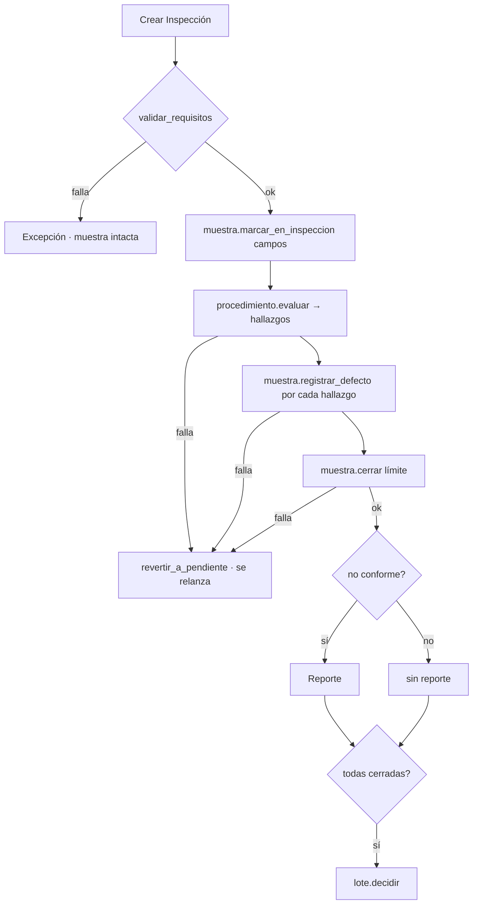
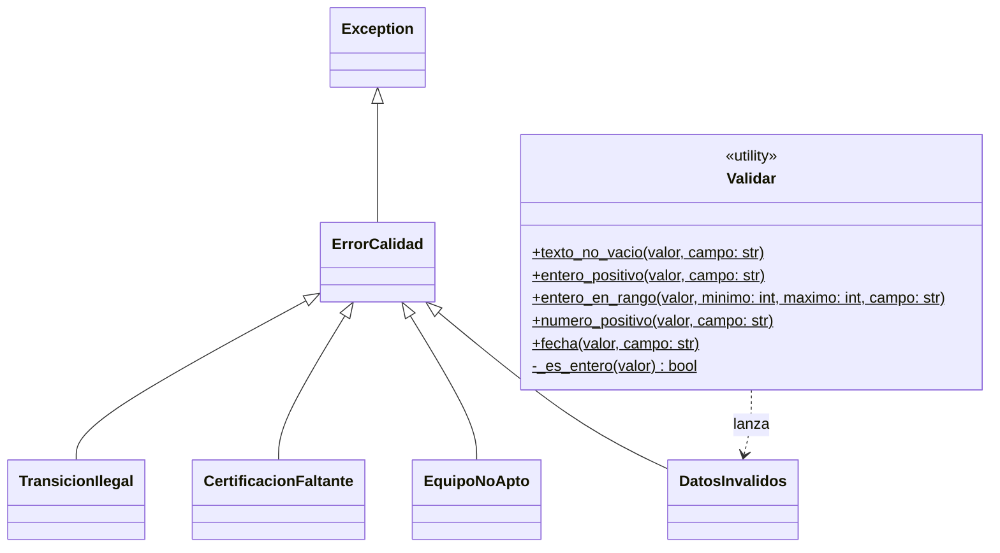

# Sistema de Monitoreo de Calidad Industrial

Prototipo en Python que coordina inspecciones de calidad sobre lotes de producción y determina la conformidad de muestras y lotes aplicando umbrales definidos.

Trabajo práctico de **Estructura de Datos** — Programación Orientada a Objetos, solo biblioteca estándar.

> Este README se escribe **en paralelo al código**. Cada sección se agrega cuando la parte correspondiente queda resuelta, así el documento final permite seguir la línea de tiempo del proyecto.

---

## Bitácora

| Etapa | Qué se hizo | Estado |
|---|---|---|
| 1 | Modelo lógico y UML | Terminada |
| 2 | Esqueleto de clases (firmas, sin lógica) | Terminada |
| 3 | Revisión del modelo lógico contra las reglas de negocio | Terminada |
| 4 | Validaciones de datos en todos los constructores, excepciones y `registrar_defecto` con `**kwargs` | Terminada |
| 5 | Implementación del resto de los métodos, incluidas la corrección de `Inspeccion` y el `Registro` | Terminada |
| 6 | Pruebas con `pytest`, un archivo por clase | Terminada |
| 7 | Persistencia: el `Registro` se guarda y se carga con `pickle` | Terminada |
| 8 | Estructuras de datos: cola enlazada con consultas recursivas, `Agenda` de inspecciones y conjuntos | Terminada |

### Estado actual

- El dominio está completo: el recorrido de [Cómo usarlo](#cómo-usarlo) corre de punta a punta, y `py main.py` muestra el sistema entero funcionando (ver [El recorrido completo](#el-recorrido-completo-mainpy)).
- Las 253 pruebas pasan.
- La segunda entrega suma la `Agenda`, que procesa inspecciones en orden de llegada con una **cola enlazada** propia; la **recursividad**, en las consultas de esa cola; y **conjuntos** donde la pregunta es de pertenencia o de diferencia. Ver [Estructuras de datos](#estructuras-de-datos).

---

## Archivos

```
proyecto/
├── README.md
├── main.py               punto de entrada
├── ejemplo_completo.py   jornada completa, narrada paso a paso
├── sistema_calidad.py    toda la lógica del dominio
├── conftest.py           hace que los tests encuentren sistema_calidad
├── pytest.ini            marca la raíz del proyecto para pytest
└── tests/                pruebas con pytest, un archivo por clase
```

La consigna exige separar el punto de entrada de la lógica del dominio. Por eso `main.py` arma objetos y los usa, pero no contiene ni una regla de negocio. Por el mismo motivo, las clases del dominio no imprimen nada por pantalla: informan con valores de retorno o con excepciones, y es `main.py` quien decide qué mostrar.

---

## Cómo funciona el sistema

1. Se crea un **Lote** con una cantidad fabricada.
2. Se le agregan **Muestras**. Cada una representa una cantidad de unidades y nace `PENDIENTE`.
3. Se elige un **Procedimiento** y se crea una **Inspección**, que vincula muestra, profesional, equipo, procedimiento y fecha.
4. La inspección **valida los requisitos** antes de tocar nada. Si algo falla, lanza una excepción y la muestra queda exactamente como estaba.
5. Si pasa, la muestra va a `EN_INSPECCION`. El procedimiento convierte las observaciones en cero o más hallazgos, y cada uno se registra en la muestra como **Defecto** con `registrar_defecto`. Si algo de esto falla, la muestra vuelve a `PENDIENTE` sin defectos.
6. La muestra **cierra**: `NO_CONFORME` si hay un defecto crítico o si la suma de gravedades supera el límite del procedimiento; `CONFORME` en caso contrario. Ambos estados son finales.
7. Si quedó no conforme, se emite exactamente un **Reporte** con una copia congelada de los defectos.
8. Cuando **todas** las muestras están cerradas, el lote se decide: `RECHAZADO` si el porcentaje de no conformes supera estrictamente el 5 %.

Las inspecciones se pueden ejecutar de a una, o **programarse en una `Agenda`**, que las procesa en orden de llegada, registra las que salieron bien y devuelve un resumen de completadas y fallidas.



---

## Cómo usarlo

Un recorrido completo, de punta a punta. Los resultados de los comentarios son los que da al correrlo.

```python
from datetime import date
from sistema_calidad import (Lote, Muestra, Profesional, Certificacion, Equipo,
                             ProcedimientoDimensional, ProcedimientoVisual,
                             Inspeccion, ErrorCalidad)

hoy = date(2026, 9, 23)

# 1. Lote y muestras
lote = Lote(1000)
m1 = Muestra(10)
m2 = Muestra(10)
lote.agregar_muestra(m1)
lote.agregar_muestra(m2)

# 2. Quién inspecciona y con qué
ana = Profesional("Ana")
ana.agregar_certificacion(Certificacion("Metrologia", date(2027, 3, 1)))
calibre = Equipo("calibre", date(2026, 8, 1))
camara = Equipo("camara", date(2026, 9, 1))

# 3. Procedimientos: límite, categoría de equipo, certificación y datos propios
dimensional = ProcedimientoDimensional(5, "calibre", "Metrologia",
                                       nominal_mm=10.0, tolerancia_mm=0.1)
visual = ProcedimientoVisual(4, "camara", None, zonas_criticas=("borde",))

# 4. Inspeccionar: cada procedimiento recibe su propio formato
reporte = Inspeccion(m1, ana, calibre, dimensional, hoy).ejecutar([10.02, 10.35])
print(reporte)            # un defecto de gravedad 4 <= 5 -> CONFORME -> None

reporte = Inspeccion(m2, ana, camara, visual, hoy).ejecutar(
    [{"zona_afectada": "borde", "patron": "fisura"}])
print(reporte)            # zona crítica -> gravedad 5 -> NO_CONFORME -> Reporte

# 5. Consultas y decisión del lote
print(lote.porcentaje_no_conformes())   # 50.0
print(lote.contar_criticos())           # 1
print(lote.contar_defectos_por_tipo())  # {'dimensional': 1, 'visual': 1}
print(lote.decidir())                   # EstadoLote.RECHAZADO

# 6. Todos los errores del dominio heredan de ErrorCalidad
try:
    lote.agregar_muestra(Muestra(5))    # el lote ya está decidido
except ErrorCalidad as error:
    print(type(error).__name__, "-", error)
```

La primera muestra quedó `CONFORME` aunque tiene un defecto: la conformidad no es "cero defectos", sino "ningún crítico y la suma dentro del límite". Por eso su defecto aparece en `contar_defectos_por_tipo()`.

### Procesar varias inspecciones con la Agenda

Continuando el ejemplo anterior:

```python
from sistema_calidad import Registro, Agenda

registro = Registro()
agenda = Agenda(registro)

lote2 = Lote(500)
m3, m4, m5 = Muestra(10), Muestra(10), Muestra(10)
for muestra in (m3, m4, m5):
    lote2.agregar_muestra(muestra)

# Se programan en orden de llegada; todavía no se ejecuta nada
agenda.programar(Inspeccion(m3, ana, calibre, dimensional, hoy), [10.0, 10.05])
agenda.programar(Inspeccion(m4, ana, camara, visual, hoy),
                 [{"zona_afectada": "cara", "patron": "raya"}])
agenda.programar(Inspeccion(m5, ana, calibre, dimensional, hoy),
                 [10.1, "diez"])                      # dato mal cargado

print(agenda.pendientes())            # ['Insp2', 'Insp3', 'Insp4']
print(agenda.cantidad_pendientes())   # 3

# Se procesan todas, la más antigua primero
print(agenda.procesar_todas())
# {'completadas': 2, 'fallidas': 1, 'ids_fallidas': ['Insp4']}

print(m5.get_estado())                # EstadoMuestra.PENDIENTE (rollback)
print(len(registro.inspecciones()))   # 2: solo se registran las que salieron bien
```

La inspección fallida salió de la cola igual, y su muestra quedó `PENDIENTE`: se puede volver a programar con las observaciones corregidas.

### Guardar y cargar el Registro

```python
registro.registrar_lote(lote2)
registro.guardar("registro.pkl")

registro = Registro.cargar("registro.pkl")
print(registro.obtener_lote("Lot1"))   # id:Lot1 - fabricadas:500 - muestras:3 - estado:ABIERTO
```

Al cargar, los contadores de id de cada clase se adelantan al mayor id guardado, así los objetos que se creen después no repiten ids.

### Qué recibe `ejecutar()` según el procedimiento

| Procedimiento | Observaciones | Ejemplo |
|---|---|---|
| `ProcedimientoDimensional` | Lista de mediciones en mm (`int` o `float`, finitos y positivos) | `[10.02, 10.35]` |
| `ProcedimientoVisual` | Lista de diccionarios con `zona_afectada` y `patron` | `[{"zona_afectada": "borde", "patron": "fisura"}]` |

Una lista vacía es válida: no genera hallazgos y la muestra cierra `CONFORME`. Cualquier otro formato lanza `DatosInvalidos`, la muestra vuelve a `PENDIENTE` y la misma inspección se puede reintentar con los datos corregidos.

### Qué se puede consultar

| Objeto | Método | Devuelve |
|---|---|---|
| `Lote` | `muestras()` | Lista nueva con las muestras |
| | `unidades_asignadas()` | Suma de unidades de todas las muestras |
| | `todas_cerradas()` | `True` si ninguna está `PENDIENTE` ni `EN_INSPECCION` |
| | `porcentaje_no_conformes()` | No conformes / totales × 100, sin redondear |
| | `contar_criticos()` | Defectos de gravedad 5 en muestras cerradas |
| | `contar_defectos_por_tipo()` | Diccionario `{tipo: cantidad}` en muestras cerradas |
| | `decidir()` | `EstadoLote.APROBADO` o `RECHAZADO` (una sola vez) |
| `Reporte` | `causas()` | Tupla con los defectos que causaron el rechazo |
| | `resumen()` / `str(reporte)` | Texto con muestra, lote, profesional, fecha y causas |
| `Muestra` | `defectos()` | Tupla con sus defectos |
| | `get_estado()` | `EstadoMuestra` actual |
| | `esta_pendiente()` / `esta_cerrada()` / `es_no_conforme()` | Consultas de estado |
| `Defecto` | `es_critico()` | `True` si la gravedad es 5 |
| | `datos_observacion()` | Copia del diccionario con los datos propios de la observación |
| `Agenda` | `pendientes()` | Lista con los ids de las inspecciones programadas, en orden de procesamiento |
| | `cantidad_pendientes()` | Cuántas inspecciones esperan |
| | `procesar_siguiente()` | Procesa la del frente; devuelve el `Reporte` o `None` |
| | `procesar_todas()` | Procesa toda la cola y devuelve `{"completadas", "fallidas", "ids_fallidas"}` |
| `Cola` | `cantidad()` / `a_lista()` | Cantidad de elementos / lista nueva con los datos en orden (recursivas) |
| | `frente()` | El dato del inicio, sin sacarlo |
| `Registro` | `inspecciones()` / `reportes()` | Lista nueva con lo registrado, en orden de alta |
| | `obtener_lote(id)`, `obtener_profesional(id)`… | El objeto con ese id en su categoría |

Los getters de atributos siguen la misma convención: `get_id()`, `get_estado()`, `get_lote()`, `get_fecha()`, etc. Las consultas que devuelven una colección o calculan algo llevan un nombre propio: `defectos()`, `muestras()`, `causas()`, `datos_observacion()`, `campos_observacion()`.

### El recorrido completo: `main.py`

```
py main.py
```

Recorre el sistema entero en cinco partes, mostrando cada resultado y cada error esperado:

1. **Escenario:** dos lotes, dos profesionales, tres equipos y los dos procedimientos, todos dados de alta en un `Registro`. Intenta registrar dos veces el mismo lote y decidir un lote sin inspeccionar.
2. **Inspecciones de a una (lote 1):** una muestra conforme con un defecto, una no conforme por un defecto crítico, una no conforme por suma sin ningún crítico, el intento de reinspeccionar una muestra cerrada, y dos inspecciones que fallan por requisitos (certificación y equipo) y se reintentan.
3. **Agenda (lote 2):** veinte inspecciones en orden de llegada, una con un dato mal cargado que falla, hace rollback y se vuelve a programar corregida.
4. **Decisión de los lotes:** el lote 1 queda `RECHAZADO` (50 %) y el lote 2 `APROBADO` con exactamente 5 %, el borde de la consigna.
5. **Persistencia:** guarda el `Registro` en `registro.pkl` y lo vuelve a cargar.

Las inspecciones usan la fecha del día (`date.today()`), y las demás fechas del ejemplo se calculan a partir de ella con `timedelta`, así el resultado es el mismo cualquier día que se corra. El dominio, en cambio, nunca llama a `date.today()`: la fecha le llega siempre por parámetro.

### Un ejemplo más largo: `ejemplo_completo.py`

```
py ejemplo_completo.py
```

Una jornada completa de la planta, narrada paso a paso, que usa prácticamente todos los métodos públicos del dominio. Veinte inspecciones pasan por la `Agenda`: cuatro fallan por motivos distintos (certificación vencida, calibración vencida, una medición mal cargada y un hallazgo incompleto), se corrigen y se vuelven a programar. Otras tres se ejecutan de a una, y el ejemplo muestra los reportes, la inmutabilidad de una muestra cerrada, la decisión de dos lotes, la cola por dentro y la persistencia. Guarda el registro en un archivo temporal y lo borra al terminar.

### Cómo correr las pruebas

Desde la raíz del proyecto:

```
py -m pytest -v
```

- **Un archivo por clase.**
- **Un fixture `autouse` reinicia los contadores de id antes de cada test.** Los contadores son atributos de clase y no se reinician solos; sin el fixture, un test no puede esperar un id exacto como `"Lot0"`.
- **Las excepciones se chequean con `match=`** y un fragmento del mensaje, para verificar no solo el tipo de error sino cuál de las validaciones saltó.
- **Cada test rompe una sola regla por vez**, porque si fallan dos, sale la excepción de la que se valida primero.
- **`test_lote.py` cierra las muestras a mano**, sin pasar por `Inspeccion`, para probar el lote aislado de las demás clases.
- **`test_cola.py` prueba la cola sin ningún objeto del dominio**, porque la cola es genérica; `test_agenda.py` arma un escenario completo y prueba el orden de procesamiento, el resumen y qué pasa con una inspección fallida.

---

## Las clases

| Clase | Responsabilidad |
|---|---|
| `Registro` | Garantiza identificadores únicos por categoría; se guarda y se carga con `pickle` |
| `Agenda` | Programa inspecciones y las procesa en orden de llegada |
| `Cola` / `Nodo` | Cola enlazada (FIFO) genérica, con consultas recursivas |
| `Lote` | Identidad, cantidad fabricada, muestras, estado y decisión final |
| `Muestra` | Defectos, estado y resultado de conformidad |
| `Defecto` | Tipo, descripción, gravedad y datos propios de la observación |
| `Procedimiento` *(abstracta)* | Requisitos, límite, campos de observación y criterio de evaluación |
| `ProcedimientoDimensional` | Compara mediciones contra nominal ± tolerancia |
| `ProcedimientoVisual` | Clasifica hallazgos según la zona |
| `Profesional` | Identidad y certificaciones vigentes |
| `Certificacion` | Nombre y vencimiento |
| `Equipo` | Identidad, categoría y última calibración |
| `Inspeccion` | Orquesta la ejecución completa |
| `Reporte` | Respaldo inmutable de una muestra no conforme |
| `Validar` | Chequeos de datos reutilizables (`staticmethod`) |

Los enums `EstadoMuestra` y `EstadoLote` evitan que un estado se escriba como string con un typo. Por lo mismo, un estado se consulta con los métodos de la clase (`esta_pendiente()`, `es_no_conforme()`) y nunca se compara contra un texto como `'PENDIENTE'`.

---

## Decisiones de diseño

### El procedimiento vive en la Inspección, no en la Muestra

Si viviera en la muestra, la muestra quedaría acoplada a un tipo de procedimiento. Poniéndolo en la inspección, la muestra solo recibe dos datos: los campos de observación al iniciar y el límite de gravedad al cerrar. Sigue siendo dueña de sus defectos y de su conformidad, pero sin saber quién se la dictaminó.

### La Inspección valida todo junto

Es el único objeto que ve a los cuatro participantes a la vez. Si validara la muestra, habría que pasarle profesional y equipo, y la muestra no tiene por qué conocerlos.

### La herencia está en `Procedimiento`

Es donde hay comportamiento realmente distinto: todos los procedimientos se ejecutan con la misma operación, `evaluar()`, pero cada uno recibe observaciones con otro formato y aplica su propio criterio para calcular la gravedad. `Inspeccion` los usa sin saber cuál le tocó, y agregar un procedimiento nuevo no obliga a tocar ni `Muestra` ni `Lote`.

`Procedimiento` es abstracta (`ABC` con `evaluar()` como `@abstractmethod`): Python no permite instanciarla y obliga a cada subclase a implementar su propio `evaluar()`. Las subclases validan sus datos propios antes de llamar a `super().__init__()`, así un procedimiento inválido no consume un id.

`evaluar()` es pura: no toca la muestra, no guarda estado y devuelve hallazgos nuevos en cada llamada.

**Dimensional:** `max(1, ceil(min(5, desviacion / tolerancia)))` — cuántas veces la desviación se pasó de la tolerancia, redondeado hacia arriba, con techo en 5 y piso en 1 (en el código, `Defecto.GRAVEDAD_MAXIMA` y `Defecto.GRAVEDAD_MINIMA`). El techo se aplica antes de `ceil`: da el mismo resultado que aplicarlo después, pero un cociente enorme (por ejemplo, con una tolerancia diminuta) se recorta a 5 en vez de romper `ceil`. Una medición dentro de tolerancia no genera hallazgo, así que el cociente nunca baja de 1: en la práctica la gravedad va de 2 a 5, y solo da 1 cuando la medición se pasa de la tolerancia por una fracción despreciable. El piso es una segunda línea de defensa del rango. La desviación y el cociente se redondean a 6 decimales antes de aplicar `ceil`, porque con flotantes `|10.3 − 10.0| / 0.1` da `3.000000000000007` y `ceil` daría 4 en vez de 3. La tolerancia no se redondea: una menor a 0.000001 quedaría en 0. Antes de calcular nada se validan todas las mediciones: cada una tiene que ser un número finito y positivo, porque es una longitud.

**Visual:** pesa menos que el dimensional. Si la zona es crítica la gravedad es 5; en cualquier otra zona es un valor fijo que define el procedimiento, validado entre 1 y 4.

### Los defectos se registran con `**kwargs`

`Muestra.registrar_defecto(tipo, descripcion, gravedad, **datos_observacion)` registra cada defecto con los datos propios de la observación que lo produjo. El dimensional pasa `valor_medido_mm`, `nominal_mm` y `tolerancia_mm`; el visual pasa `zona_afectada` y `patron`. Ninguno recibe parámetros vacíos que no le corresponden.

Por eso `Defecto` es una sola clase: la gravedad llega calculada por el procedimiento, y lo único que diferencia a un defecto de otro son su tipo (`"dimensional"` o `"visual"`, el `TIPO_DEFECTO` del procedimiento que lo produjo) y sus campos, que se guardan en un diccionario. `Defecto` valida que tipo y descripción no estén vacíos, que el tipo sea uno de los de su conjunto `TIPOS_VALIDOS` y que la gravedad sea un entero entre 1 y 5.

Cada procedimiento declara sus `CAMPOS_OBSERVACION`. Al iniciar la inspección, la muestra recibe esos campos, y `registrar_defecto` rechaza un defecto con campos de más o de menos: los calcula como diferencia de conjuntos (ver [Estructuras de datos](#estructuras-de-datos)). Así se cumple que los datos del defecto sean coherentes con el procedimiento sin que la muestra lo conozca.

`**kwargs` se usa solo acá, porque es el único lugar donde cada procedimiento manda campos distintos. En los constructores los parámetros son explícitos: con `**kwargs`, un nombre mal escrito (`tolerncia_mm=0.1`) se aceptaría en silencio. En `registrar_defecto` ese riesgo lo cubre el control contra `CAMPOS_OBSERVACION`: un campo mal escrito aparece como sobrante y el defecto se rechaza.

`Inspeccion` desempaqueta cada hallazgo con `muestra.registrar_defecto(**hallazgo)`. Las validaciones siguen este orden, y recién después se agrega el defecto:

1. La muestra está `EN_INSPECCION`; si no, `TransicionIlegal`. Impide registrar defectos ajenos a la inspección en curso o sobre una muestra cerrada.
2. Los campos coinciden exactamente con los del procedimiento; si no, `DatosInvalidos`.
3. Tipo, descripción y gravedad son válidos; si no, `DatosInvalidos`.

### Una inspección fallida devuelve la muestra a `PENDIENTE`

`EN_INSPECCION` es un estado transitorio, y la inspección lo abre antes de saber si las observaciones son válidas. Si la evaluación o el registro de un defecto fallan, la muestra quedaría atrapada ahí: no vuelve a estar `PENDIENTE`, así que no admite otra inspección, y no está cerrada, así que el lote entero nunca podría decidirse. Un dato mal cargado bloquearía un lote de mil piezas.

Por eso `Inspeccion.ejecutar()` envuelve evaluación, registro y cierre en un `try`, y ante cualquier error llama a `Muestra.revertir_a_pendiente()` antes de relanzar la excepción. La muestra vuelve a `PENDIENTE`, sin defectos y sin campos en curso. Los defectos se descartan porque entran de a uno: si falla el tercer hallazgo, los dos primeros ya están registrados y pertenecen a un intento que no llegó a producir resultado.

Es una transición hacia atrás, y es deliberada. Lo que la vuelve segura es su precondición: solo se puede ejecutar desde `EN_INSPECCION`. Desde `CONFORME` o `NO_CONFORME` lanza `TransicionIlegal`, así que nunca sirve para reabrir una muestra cerrada.

La inspección se marca como ejecutada solo si todo salió bien, así que un intento fallido puede repetirse con observaciones corregidas.

### El reporte se emite fuera del `try`

Cuando se construye el reporte, la muestra ya está cerrada y no se puede revertir, así que el reporte no puede fallar: una muestra no conforme sin reporte rompería la regla 10. Por eso todo lo que `Reporte` valida está garantizado antes de llegar ahí. La fecha y el lote de la muestra los chequea el constructor de `Inspeccion`; el `if` que decide emitirlo garantiza que la muestra es no conforme; y `ejecutar()` le pasa `muestra.get_lote()` y `muestra.defectos()`, que son coherentes por definición.

### El Reporte controla que lo que recibe sea coherente

`Reporte` no confía en quien lo construye. Antes de asignarse un id valida, en este orden:

1. Que la fecha sea un `date`.
2. Que reciba una `Muestra` y un `Profesional`.
3. Que la muestra pertenezca al lote indicado.
4. Que la muestra esté `NO_CONFORME`: una conforme no genera reporte.
5. Que los defectos sean una tupla con al menos uno.
6. Que esos defectos sean exactamente los de la muestra: un reporte no puede explicar un rechazo con causas ajenas.

Cualquier falla lanza `DatosInvalidos`. Por el camino normal nunca se dispara, pero cierra la puerta a un reporte armado a mano con datos que no corresponden.

`causas()` devuelve la misma tupla que recibió. No hace falta copiarla: una tupla no se puede modificar y los `Defecto` que contiene son inmutables, así que las causas quedan estables aunque la muestra se siga consultando. `__str__` delega en `resumen()`, así el texto se arma en un solo lugar.

### La conformidad se deriva y después se congela

Se calcula al cerrar, a partir de los defectos, y queda fija en `_estado`. Como después del cierre los defectos ya no se pueden tocar, no hay forma de que el estado contradiga a los defectos.

### Un lote sin muestras no es evaluable

`porcentaje_no_conformes()` y `decidir()` sobre un lote vacío lanzan `DatosInvalidos`. Podría haberse devuelto `0.0`, pero un 0 % da a entender que el lote está en condiciones de aprobarse, cuando en realidad no hay nada sobre qué opinar.

`decidir()` lo chequea por su cuenta, porque `todas_cerradas()` sobre un conjunto vacío devuelve `True` de forma trivial. Sus validaciones van en este orden: lote ya decidido (`TransicionIlegal`), lote sin muestras (`DatosInvalidos`), alguna muestra sin cerrar (`TransicionIlegal`). Con exactamente 5 % el lote queda `APROBADO`: el rechazo exige superar el umbral.

`contar_criticos()`, en cambio, devuelve `0` sobre un lote sin muestras cerradas: ahí el conjunto vacío sí tiene una respuesta con sentido.

### Las consultas del lote no tienen efectos secundarios

`porcentaje_no_conformes()`, `contar_criticos()`, `contar_defectos_por_tipo()`, `todas_cerradas()`, `unidades_asignadas()` y `muestras()` solo leen: se pueden llamar las veces que haga falta y no cambian ni muestras, ni reportes, ni el estado del lote (regla 12). La única que cambia el lote es `decidir()`, y solo una vez.

El porcentaje es la fórmula de la consigna, `no_conformes / totales * 100`, sin redondear, sobre la cantidad de muestras del lote. Se puede pedir antes de decidir como cálculo preliminar: las muestras todavía abiertas cuentan en el total, pero no como no conformes. Los conteos de críticos y por tipo, en cambio, consideran solo muestras cerradas, porque los defectos de una muestra en curso todavía pueden descartarse por un rollback.

Todo se calcula a mano, recorriendo las muestras con `for` y acumulando en un entero o en un diccionario `{tipo: cantidad}`, como pide la consigna.

### Los identificadores son autoincrementales

Cada clase con identidad lleva un contador de clase y asigna su id al final del constructor, **después** de validar. Un objeto que no llega a construirse no consume un número. En las subclases de `Procedimiento`, los datos propios se validan antes de llamar a `super()` por el mismo motivo.

`Reporte` también tiene contador propio (`"Rep0"`, `"Rep1"`, …), igual que el resto de las entidades.

Así el id nunca está vacío ni se repite entre objetos distintos. `Registro` sigue siendo la barrera para lo que el contador no cubre, como registrar dos veces el mismo objeto.

Los contadores son de clase y no se reinician solos. Por eso los tests usan un fixture que los vuelve a 0 antes de cada prueba; sin eso, un test no puede esperar un id exacto como `"Lot0"`.

### La Muestra guarda una referencia a su Lote

La asigna `lote.agregar_muestra()` una sola vez y nunca se puede reasignar. Así el reporte identifica el lote sin que nadie se lo pase por separado, y se cumple que una muestra no puede moverse a otro lote. Una muestra sin lote no se puede inspeccionar.

`agregar_muestra()` valida cinco condiciones **antes** de incorporar la muestra al diccionario interno:

1. Que lo recibido sea una `Muestra` (`DatosInvalidos`).
2. Que el lote siga abierto (`TransicionIlegal`). Agregar una muestra pendiente a un lote decidido contradiría una decisión final.
3. Que la muestra no tenga lote (`TransicionIlegal`).
4. Que su id no se repita en el lote (`DatosInvalidos`). Con ids autoincrementales es un chequeo defensivo, porque el caso "misma muestra dos veces" ya lo corta la condición 3.
5. Que las unidades no excedan la cantidad fabricada (`DatosInvalidos`). Llegar justo a la cantidad fabricada está permitido.

Si validara después, un rechazo dejaría la muestra ya metida en el lote equivocado.

### Las transiciones son públicas pero tienen dueño

`marcar_en_inspeccion()`, `registrar_defecto()`, `cerrar()` y `revertir_a_pendiente()` son públicas porque Python no tiene visibilidad de paquete. Su único llamador legítimo es `Inspeccion.ejecutar()`, y así está documentado en cada una.

La protección real son las precondiciones: cada método verifica su estado de partida y lanza `TransicionIlegal` si no corresponde. Ninguna secuencia de llamadas puede dejar la muestra en un estado incoherente.

Lo que las precondiciones no pueden garantizar es que se hayan validado profesional y equipo, ni que se emita el reporte: eso lo asegura solo el camino de `Inspeccion.ejecutar()`. Llamar a las transiciones a mano desde afuera es un uso incorrecto de la clase.

### Cada clase lee a las demás por sus getters

Ninguna clase lee un atributo privado (`_algo`) de otra: siempre pasa por un getter o por una consulta como `esta_pendiente()`. Es lo que permite cambiar cómo guarda sus datos una clase sin romper a las que la usan, y es lo que pide la consigna cuando exige encapsular estados y decisiones.

### Validaciones reutilizables como `staticmethod`

Los chequeos que se repiten en varias clases viven en `Validar`: texto no vacío, entero positivo, entero en rango, número positivo y fecha. Son `staticmethod` porque no dependen de ningún objeto: reciben el valor y el nombre del campo, y lanzan `DatosInvalidos` si el dato está mal. Tres detalles deliberados:

- `True` y `False` no se aceptan como enteros, porque en Python `bool` hereda de `int`.
- `datetime` no se acepta como fecha, porque compararlo con un `date` lanza `TypeError`.
- `NaN` e infinito no se aceptan como número positivo: un `NaN` pasaría todos los controles sin generar ningún defecto, y un infinito rompería el cálculo de la gravedad.

Los procedimientos también convierten observaciones mal formadas en `DatosInvalidos`, para que un error de datos nunca salga como `TypeError`.

### Las colecciones se devuelven copiadas

Ningún método devuelve la colección interna de un objeto: siempre una copia. Si `Muestra.defectos()` devolviera su lista real, cualquiera podría agregarle defectos a una muestra ya cerrada desde afuera.

En dos lugares esa copia es directamente una tupla — `Muestra.defectos()` y `Reporte.causas()` — porque el enunciado exige una *copia inmutable* de los defectos. También son tuplas las configuraciones que no cambian nunca: `CAMPOS_OBSERVACION` y `zonas_criticas`. `CAMPOS_OBSERVACION` es un atributo de clase compartido por todos los procedimientos de ese tipo: si fuera una lista, un `append` accidental lo cambiaría para todos.

`Lote` guarda sus muestras en un diccionario indexado por id, y `muestras()` devuelve una lista nueva. El `Registro` guarda todas sus categorías, inspecciones y reportes incluidos, en diccionarios indexados por id: la unicidad se chequea con `in` y la búsqueda por id es directa. Los conjuntos y la cola enlazada tienen su propia sección más abajo.

### La fecha siempre entra por parámetro

Ningún método del dominio llama a `date.today()`. La fecha de inspección se le pasa a `Inspeccion` en el constructor. Es lo que permite testear los bordes exactos de calibración y certificación sin que el resultado dependa del día en que se corran las pruebas.

### El Registro se guarda y se carga con `pickle`

La consigna pone la persistencia fuera de alcance: no se exige, pero tampoco se prohíbe. La agregamos como extensión con la biblioteca estándar, sin cambiar ninguna regla del dominio.

`guardar(nombre_archivo)` escribe el registro completo, con todo lo que cuelga de él (lotes con sus muestras y defectos, inspecciones, reportes). Los dos abren el archivo con `with`, que lo cierra aunque `pickle` falle. `cargar(nombre_archivo)` lo lee y además **actualiza los contadores de id** de cada clase. Si el archivo no contiene un `Registro`, lanza `DatosInvalidos`. Sin ese paso, después de cargar los contadores arrancarían en 0 y la próxima `Muestra(10)` nacería con un id que ya existe en el registro cargado. Las muestras no tienen categoría propia en el `Registro`, así que sus ids se buscan recorriendo los lotes.

---

## Estructuras de datos

### La Agenda procesa las inspecciones con una cola enlazada

Las inspecciones se procesan en orden de llegada: la primera que se programa es la primera que se ejecuta. Eso es una **cola** (FIFO): se agrega por el final y se saca por el inicio.

La cola está implementada con **nodos enlazados**, como se vio en clase: cada `Nodo` guarda un dato y la referencia al siguiente, y la `Cola` mantiene dos referencias, `_inicio` y `_final`. Así agregar al final y sacar del inicio son operaciones directas, sin importar cuántos elementos haya. Con una lista de Python, sacar el primero (`lista.pop(0)`) obliga a correr todos los demás un lugar.

La `Cola` es genérica: no sabe nada de inspecciones. La usa la `Agenda`, que guarda pares `(inspeccion, observaciones)`.

`Agenda` es una clase aparte, y no métodos del `Registro`, porque el `Registro` solo guarda lo que ya existe y no ejecuta inspecciones. La `Agenda` ejecuta, y le entrega al `Registro` lo que salió bien.

**Qué pasa si una inspección falla.** Igual sale de la cola, y la excepción sigue de largo (con `procesar_siguiente()`) o se cuenta en el resumen (con `procesar_todas()`). Las alternativas se descartaron a propósito:

- **Reencolarla al final** la haría girar para siempre si el problema es permanente, como una certificación vencida.
- **Dejarla al frente** bloquearía a todas las que esperan detrás: es el mismo problema que resuelve el rollback de `Inspeccion`.

Gracias a ese rollback, la muestra de una inspección fallida queda `PENDIENTE`, así que se puede volver a programar una vez corregido el problema. `ids_fallidas` en el resumen dice cuáles.

`programar()` también rechaza una inspección que ya está en el `Registro`: las que pasan por la Agenda las registra ella al procesarlas. Si se aceptara, la inspección se ejecutaría igual, fallaría al registrarse y aparecería como "fallida para volver a programar" sobre una muestra que ya quedó cerrada. Para eso el `Registro` ofrece la consulta `tiene_inspeccion(id)`.

`procesar_todas()` atrapa solo `ErrorCalidad`, es decir, los errores del dominio. Un error de programación (un `TypeError`, por ejemplo) no es una "inspección fallida" y no se esconde en el resumen.

### La recursividad está en las consultas de la cola

`Cola.cantidad()` y `Cola.a_lista()` recorren los nodos de forma recursiva. Una cadena de nodos es recursiva por naturaleza: un nodo es un dato más "el resto de la cadena", que a su vez empieza en otro nodo.

```python
def _contar_desde(self, nodo):
    if nodo is None:                               # caso base: no hay más nodos
        return 0
    return 1 + self._contar_desde(nodo.siguiente)  # este nodo + el resto
```

Cada consulta tiene un método público, que arranca desde `_inicio`, y uno privado, que recibe el nodo actual y se llama a sí mismo con el siguiente. Con tres elementos, `cantidad()` resuelve `1 + (1 + (1 + 0)) = 3`. Las dos consultas solo leen: no modifican la cola. La `Agenda` las usa en `cantidad_pendientes()` y `pendientes()`.

Límite conocido: Python corta la recursión alrededor de las 1000 llamadas. Para una cola de inspecciones de un laboratorio alcanza de sobra; con millones de elementos habría que recorrer con un `while`.

### Los conjuntos responden pertenencia y diferencia

Se usan `set` donde la pregunta es "¿está o no está?" o "¿qué hay en uno que no está en el otro?":

| Dónde | Pregunta | Operación |
|---|---|---|
| `Defecto.TIPOS_VALIDOS` | ¿Este tipo de defecto existe? | Pertenencia (`in`). Sumar un procedimiento nuevo solo obliga a agregar su tipo acá |
| `Muestra.registrar_defecto()` | ¿Qué campos faltan y cuáles sobran? | Diferencia: `esperados - recibidos` y `recibidos - esperados` |
| `Agenda._programadas` | ¿Esta inspección ya está en la cola? | Pertenencia, sin recorrer la cola nodo por nodo |

En `registrar_defecto()` los resultados pasan por `sorted()`: un conjunto no tiene orden, y sin eso el mensaje de error podría listar los campos en un orden distinto en cada corrida.

---

## Cumplimiento de la consigna

### Requerimientos técnicos obligatorios

| Requerimiento | Dónde se cumple |
|---|---|
| POO, con el punto de entrada separado del dominio | `sistema_calidad.py` (dominio) y `main.py` (punto de entrada) |
| Herencia con especialización real y variación polimórfica | `Procedimiento` (abstracta) → `ProcedimientoDimensional` y `ProcedimientoVisual`, cada uno con su `evaluar()` |
| Defectos, estados y decisiones encapsulados | Atributos privados, estados como `Enum`, transiciones de `Muestra` con precondiciones, `Lote.decidir()` como única forma de cambiar el lote, colecciones devueltas como copias |
| Excepciones propias | `ErrorCalidad` → `DatosInvalidos`, `EquipoNoApto`, `CertificacionFaltante`, `TransicionIlegal` |
| Cálculos manuales con estructuras nativas | `Muestra.suma_gravedades()`, `Lote.unidades_asignadas()`, `Lote.porcentaje_no_conformes()`, `Lote.contar_criticos()`, `Lote.contar_defectos_por_tipo()`: todos con `for` y acumuladores, sin `sum()` ni `Counter` |
| `date` para calibraciones, certificaciones e inspecciones | `Equipo`, `Certificacion`, `Inspeccion`, `Reporte`; `Validar.fecha()` rechaza todo lo que no sea `date` |
| Pruebas con `pytest` | Carpeta `tests/`, un archivo por clase |

### Reglas de negocio

| Regla | Dónde se garantiza |
|---|---|
| 1. Identidad y cantidades | Ids autoincrementales asignados después de validar; `Registro._alta()` rechaza ids repetidos; `Validar.entero_positivo()` |
| 2. Pertenencia de muestras | `Lote.agregar_muestra()` y `Muestra.asignar_lote()` |
| 3. Gravedad válida y datos coherentes | `Defecto.__init__()` y el control de campos de `Muestra.registrar_defecto()` |
| 4. Calibración inclusiva (182 días) | `Equipo.calibracion_vigente()` |
| 5. Certificación | `Certificacion.esta_vigente()`, `Profesional.tiene_certificacion_vigente()` y `Inspeccion.validar_requisitos()` |
| 6. Inicio de inspección | `Inspeccion.validar_requisitos()` y `Muestra.marcar_en_inspeccion()` |
| 7. Evaluación polimórfica | `Procedimiento.evaluar()`, llamado por `Inspeccion.ejecutar()` sin saber qué subclase es |
| 8. Conformidad de la muestra | `Muestra.cerrar()` |
| 9. Inmutabilidad al cerrar | Precondiciones de `registrar_defecto()`, `cerrar()` y `revertir_a_pendiente()`; `defectos()` devuelve una tupla |
| 10. Reporte de desviación | `Inspeccion.ejecutar()` lo emite una sola vez; `Reporte.__init__()` valida su coherencia |
| 11. Decisión del lote | `Lote.decidir()` |
| 12. Consultas sin efectos secundarios | `Lote.porcentaje_no_conformes()`, `contar_criticos()`, `contar_defectos_por_tipo()` |

### Decisiones de diseño que plantea la consigna

| Pregunta de la consigna | Respuesta | Detalle |
|---|---|---|
| ¿Cómo reciben observaciones distintas los procedimientos sin exponer la representación interna de la muestra? | Cada procedimiento recibe sus observaciones en `evaluar()` y devuelve hallazgos; la muestra solo recibe los campos esperados al iniciar y el límite al cerrar, y registra cada defecto con `**kwargs` | [El procedimiento vive en la Inspección](#el-procedimiento-vive-en-la-inspección-no-en-la-muestra), [`**kwargs`](#los-defectos-se-registran-con-kwargs) |
| ¿Quién valida en conjunto certificación, equipo y estado antes de iniciar? | `Inspeccion.validar_requisitos()`: es la única clase que ve a los cuatro participantes a la vez | [La Inspección valida todo junto](#la-inspección-valida-todo-junto) |
| ¿Cómo se conserva el contexto de una inspección sin permitir que cambien sus requisitos? | `Inspeccion` recibe muestra, profesional, equipo, procedimiento y fecha en el constructor y no tiene setters; la muestra fija los campos de observación al pasar a `EN_INSPECCION` y no cambian hasta el cierre | [Las transiciones son públicas pero tienen dueño](#las-transiciones-son-públicas-pero-tienen-dueño) |
| ¿La conformidad se almacena o se deriva de los defectos? ¿Qué evita contradicciones? | Se deriva al cerrar y queda guardada; después del cierre los defectos ya no se pueden tocar, así que estado y defectos no pueden contradecirse | [La conformidad se deriva y después se congela](#la-conformidad-se-deriva-y-después-se-congela) |
| ¿Cómo se crea una copia estable de las causas de un reporte? | `Muestra.defectos()` devuelve una tupla, y los `Defecto` son inmutables; el `Reporte` guarda esa tupla y además verifica que sean los defectos de la muestra | [El Reporte controla que lo que recibe sea coherente](#el-reporte-controla-que-lo-que-recibe-sea-coherente) |
| ¿Dónde se ubica la decisión del lote para no acoplarla a un tipo particular de procedimiento? | En `Lote.decidir()`, que solo pregunta a cada muestra si es no conforme; el lote no conoce a ningún procedimiento | [Un lote sin muestras no es evaluable](#un-lote-sin-muestras-no-es-evaluable) |

### Pruebas mínimas esperadas

| Prueba mínima | Tests que la cubren |
|---|---|
| Ids duplicados, cantidades inválidas y muestras que exceden el lote | `test_registro.py`: `test_registrar_el_mismo_lote_dos_veces_lanza_error`, `test_dos_lotes_distintos_con_el_mismo_id_lanza_error`; `test_lote.py`: `test_id_de_muestra_repetido_en_el_lote_lanza_error`, `test_cantidad_fabricada_cero_lanza_error`, `test_agregar_muestra_que_excede_lo_fabricado_lanza_error`, `test_agregar_justo_hasta_la_cantidad_fabricada_se_permite`; `test_muestra.py`: `test_unidades_cero_lanza_error` |
| Gravedades 1, 5 y fuera de rango | `test_defecto.py`: `test_gravedad_1_es_valida`, `test_gravedad_5_es_valida`, `test_gravedad_0_lanza_error`, `test_gravedad_6_lanza_error` |
| Calibración exactamente a 182 días y un día vencida | `test_inspeccion.py`: `test_calibracion_exactamente_a_182_dias_es_apta`, `test_calibracion_a_183_dias_lanza_error` |
| Certificación ausente, vencida y vigente en sus límites | `test_inspeccion.py`: `test_certificacion_ausente_lanza_error`, `test_certificacion_vencida_ayer_lanza_error`, `test_certificacion_vigente_el_dia_exacto_del_vencimiento` |
| Equipo de categoría incompatible | `test_inspeccion.py`: `test_equipo_de_categoria_incompatible_lanza_error` |
| Suma justo en el límite y por encima, con y sin crítico | `test_inspeccion.py`: `test_suma_justo_en_el_limite_queda_conforme` (justo, sin crítico), `test_un_defecto_critico_alcanza_para_no_conforme` (justo, con crítico), `test_suma_por_encima_del_limite_queda_no_conforme` (por encima, sin crítico), `test_suma_por_encima_del_limite_con_un_critico_queda_no_conforme` (por encima, con crítico) |
| Modificar o reinspeccionar una muestra cerrada | `test_muestra.py`: `test_registrar_defecto_en_muestra_cerrada_lanza_error`, `test_cerrar_dos_veces_lanza_error`, `test_revertir_una_muestra_cerrada_lanza_error`; `test_inspeccion.py`: `test_reinspeccionar_una_muestra_cerrada_lanza_error`, `test_ejecutar_dos_veces_la_misma_inspeccion_lanza_error` |
| Contenido y unicidad del reporte | `test_inspeccion.py`: `test_reporte_tiene_muestra_lote_profesional_fecha_y_causas`, `test_circuito_completo_un_reporte_por_muestra_no_conforme`, `test_muestra_conforme_devuelve_none_y_no_genera_reporte`; `test_registro.py`: `test_registrar_el_mismo_reporte_dos_veces_lanza_error`; `test_reporte.py` |
| Lote incompleto, exactamente 5 % y por encima | `test_lote.py`: `test_decidir_lote_incompleto_lanza_error`, `test_decidir_exactamente_5_por_ciento_aprueba`, `test_decidir_por_encima_del_5_por_ciento_rechaza` |
| Conteo de críticos sin efectos secundarios | `test_lote.py`: `test_contar_criticos_no_tiene_efectos_secundarios`, `test_contar_criticos_ignora_muestras_sin_cerrar`, `test_porcentaje_no_cambia_el_estado_del_lote` |

---

## Excepciones propias

Todas heredan de `ErrorCalidad`, así una prueba puede capturar la base cuando no le importa el motivo exacto.



`Validar` agrupa los chequeos de datos que se repiten (ver [Validaciones reutilizables](#validaciones-reutilizables-como-staticmethod)); todos sus métodos son `staticmethod` y lanzan `DatosInvalidos`.

| Excepción | Cuándo se lanza |
|---|---|
| `ErrorCalidad` | Base, no se lanza directamente |
| `DatosInvalidos` | Texto vacío, cantidad no positiva, gravedad fuera de rango, tipo de defecto desconocido, fecha que no es `date`, nominal o tolerancia no positivos, `zonas_criticas` que no es una tupla de textos, observaciones mal formadas, datos de observación incoherentes con el procedimiento, agregar a un profesional algo que no es una `Certificacion`, agregar a un lote algo que no es una muestra, muestras que exceden el lote, crear una `Inspeccion` con participantes de la clase equivocada o con una muestra sin lote, reporte incoherente (muestra conforme, de otro lote o con defectos ajenos), id duplicado, inexistente u objeto de la clase equivocada en el `Registro`, consultas sobre un lote sin muestras, desencolar o consultar el frente de una cola vacía, procesar una agenda sin pendientes, programar dos veces la misma inspección, una inspección ya registrada o algo que no es una inspección, crear una `Agenda` sin `Registro`, cargar un archivo que no contiene un `Registro` |
| `EquipoNoApto` | Categoría incompatible o calibración vencida (o con fecha futura) |
| `CertificacionFaltante` | El profesional no la tiene o está vencida |
| `TransicionIlegal` | Iniciar la inspección de una muestra que no está `PENDIENTE`, registrar defectos fuera de `EN_INSPECCION`, cerrar una muestra ya cerrada, revertir una muestra que no está `EN_INSPECCION`, reinspeccionar, ejecutar dos veces una inspección, programar una inspección ya ejecutada, mover una muestra de lote, agregar muestras a un lote decidido, decidir un lote incompleto o ya decidido |

---

## Constantes del dominio

Los valores que fija el enunciado o el diseño no se escriben sueltos en el medio del código: cada uno vive como constante de la clase dueña de esa regla.

| Constante | Valor | Clase |
|---|---|---|
| `DIAS_VIGENCIA_CALIBRACION` | 182 | `Equipo` |
| `GRAVEDAD_CRITICA` | 5 | `Defecto` |
| `GRAVEDAD_MINIMA` / `GRAVEDAD_MAXIMA` | 1 / 5 | `Defecto` |
| `TIPOS_VALIDOS` | `{"dimensional", "visual"}` | `Defecto` |
| `UMBRAL_RECHAZO_PORCENTUAL` | 5.0 | `Lote` |
| `TIPO_DEFECTO` | `"dimensional"` | `ProcedimientoDimensional` |
| `TIPO_DEFECTO` | `"visual"` | `ProcedimientoVisual` |
| `CAMPOS_OBSERVACION` | `valor_medido_mm`, `nominal_mm`, `tolerancia_mm` | `ProcedimientoDimensional` |
| `CAMPOS_OBSERVACION` | `zona_afectada`, `patron` | `ProcedimientoVisual` |
